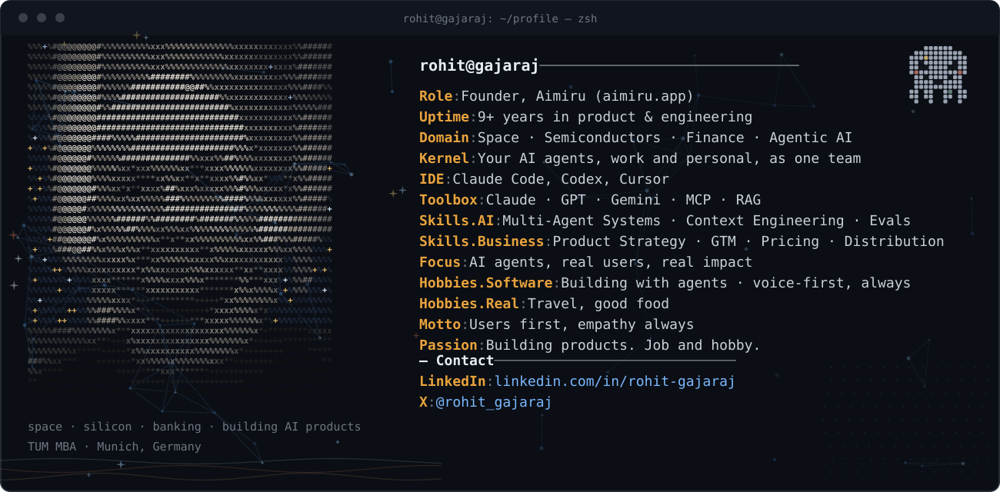

<h1> Hi, I’m Rohit 👋 </h1>

I build AI products, and I mean that literally. Right now that means Aimiru, full time. Most days you will find me in a terminal, building alongside coding agents and testing a flow myself, and then talking to the people who use agents every day, finding out why it still is not good enough. Building products is the job and the hobby.

Think of me as a product builder who also runs the business: I set the direction, I build the product myself, and I take it to market. Strategy, build, and execution in one person, not three handoffs.

<h2> What I am building: Aimiru </h2>

[**Aimiru**](https://aimiru.app) runs the AI agents you already use, work and personal, as one team. You bring your own agents, on the subscriptions you already pay for (Claude Code, Codex, ChatGPT, Claude, Muse, Fo and others), and Aimiru gives them what a team needs:

- **One brain.** Tell one of them something, and they all know it.
- **Jobs across agents.** Give a job once; Aimiru plans it and hands each part to the right agent.
- **Shared abilities.** One phone line, one email address and cards made for one job, which any agent borrows.
- **Your limits,** kept by every agent, with fewer asks as it learns your yeses.
- **One view** of everything they did, with one tap to pause them all.

Today it works inside Claude Code and Codex. The connectors are open source at [aimiru-app/aimiru-connectors](https://github.com/aimiru-app/aimiru-connectors), and the Codex connector is on npm as `aimiru-codex`.

**Why I am building it:** I live the problem. I use Claude Code, Codex, ChatGPT, Claude and Lovable for work, and Muse, Fo and Wabi for my personal life. Each is good on its own. Together they need a manager, and the manager was me.

**What I believe**

- Talk to users. Not through a dashboard, not through a report someone else wrote. I learn more from one honest conversation than from a week of metrics.
- Be practical. A feature nobody uses is not a feature, it is a cost. I would rather ship something small that people quietly love than something grand that people politely tolerate.
- A demo is a promise, and production is where the promise gets kept.
- If you cannot measure it against real data, you do not know that it works. You only hope it does.
- Taste matters more now, not less. When anyone can generate anything, the edge is knowing what is worth shipping.
- Ownership is not a poster on a wall. If it has my name on it, it ships, and I stay with it until it works for the person using it.

**Where I think this goes**

I am an optimist about AI, but not a blind one. Models will keep getting better, and the bottleneck will move from what AI can do to what we can trust it to do. People will not use one agent; they will use many, from different makers, at work and at home. The winners will be the ones who make those agents work together, safely, without making the person their manager. That is the frontier I am building on.

**Tools I use every day**

- Claude Code, my main coding agent, and Codex running alongside it
- Claude and ChatGPT as thinking partners: research, drafts, and pressure testing product decisions before they cost anyone money
- Lovable and Replit when I want a prototype I can touch quickly
- Figma and Mobbin for design
- Wispr Flow for voice to text. I talk more than I type

<h2> What I built before </h2>

**Supaprod** ([supaprod.ai](https://supaprod.ai)) - An AI system for product teams, in three layers: it read customer signals and told you what to build, had agents carry the work from spec to shipped code, and kept a brain that learned from each decision. I built it alone in about eleven weeks and stopped it in September 2026, when Linear, Atlassian and Anthropic shipped the same idea inside their own products. Knowing when to stop was the most important call I made on it.

[**Project Infinity**](https://github.com/RohitGajaraj/project-infinity) - A verified ID for AI agents that any business can check in one step: identity, permissions and signed credentials. I built the first part in September 2026.

One honest lesson from Supaprod: I once found nine shipped features doing nothing in production, even though every test was green. Tests passing is not the same as value landing. Aimiru is built the other way: one thing working end to end before the next.

<h2> The road here </h2>

- **Aimiru, Bengaluru.** Founder, building full time since October 2026.
- **Intellect.** Senior AI Product Manager. Led an AI product that more than 200 banks, central banks and financial institutions in 70+ countries use to build their own AI applications, where no AI acts without limits, a way to stop it and a record.
- **Founder, Bengaluru.** A consumer beverage brand, incubated at NSRCEL, IIM Bangalore, and recognised by Startup India. It taught me more about customers than any framework has.
- **Infineon Technologies, Munich, Germany.** Product Manager for silicon and semiconductors: consumer audio chips inside flagship smartphones.
- **Bosch.** Product Analyst, researching new payment rails built on blockchain.
- **ISRO, Bengaluru.** India's national space agency. I started my career there as a communications engineer on space and satellite communication systems for India's Moon mission and the operations of its Mars orbiter, then moved into product within eight months.
- **MBA, TUM School of Management, Munich, Germany.** I lived and worked in Germany from 2019 to 2022.

**Connect with me**

[Aimiru](https://aimiru.app) · [LinkedIn](https://www.linkedin.com/in/rohit-gajaraj) · [X](https://x.com/rohit_gajaraj)
